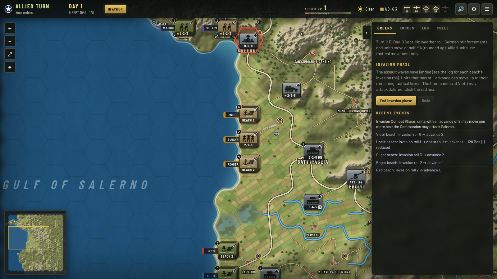

# Salerno '43 Digital

A browser version of GMT Games' **Salerno '43** for owners of the physical game, with a computer opponent. You can play either side against the built-in AI, let Claude command the other side, play hot-seat, or watch two AIs play each other.

This is a personal play aid. It contains no GMT artwork or rulebook text. The map is an original rendering of hex data transcribed from photos of the owner's map, the tables and set-up come from the owner's player aids, and the rules are implemented in the program's own code. You need your own copy of the game for the rulebook and counters.



## Running it

```bash
npm install
npm run dev        # open the printed URL (usually http://localhost:5173)
npm test           # engine and AI tests
npm run build      # static build in dist/ (open with any static web server)
npm run selfplay -- short 1 3      # three AI-vs-AI games from the command line
```

The first launch paints the map (a few seconds); the result is cached in the browser, so later launches start straight at the title screen. The game autosaves after every action and **Continue** on the title screen picks it up. Save files can be exported and imported from the pause menu (**Esc**).

### On your phone

1. On your computer, in the project folder, run:

   ```bash
   npm run phone
   ```

   It builds the game and prints two addresses. Use the **Network** one, for example `http://192.168.1.20:4173`.
2. Connect your phone to the same WiFi and open that address in Safari or Chrome.
3. Optional: use **Share → Add to Home Screen** (iPhone) or **⋮ → Add to Home screen** (Android) to get a full-screen app icon.

If the phone can't connect, allow Node through your computer's firewall when asked (on Windows, choose Private networks). The computer must stay on while you play. Saves live on the phone, separate from the computer's browser. `npm run phone:dev` does the same with the development server, which reloads when the code changes.

On a touch screen:

- **Drag** to pan and **pinch** to zoom.
- **Tap** a unit to select it and see its details.
- **Tap a highlighted hex** to preview the route, then **tap it again** to carry out the move or advance. Cancel, or tap elsewhere, to back out.
- Held upright, the orders are in a sheet at the bottom: tap **Orders** or a tab to open it, and **▾** to lower it. Held sideways, they sit in a side panel.

## Playing

### Starting an operation

1. **Title screen → New operation.** Pick the Avalanche Scenario (8 turns) or the Campaign Game (22 turns), then your role: the Allies, the Germans, both sides (hot-seat) or neither (watch the AIs fight). Choose the opponent (the built-in AI or Claude with your API key) and the optional rules 25.2 (Reconnaissance units) and 25.3 (Limited supply from ports).
2. **Briefing.** A short dispatch with your side's situation and objectives. Click **Begin** to go to the map.

### The screen

- **Top bar:** your side, the turn and date, the phases of the current player turn, the VP gauge against the turn's benchmark, the weather, supply points, support available and the sound, settings and menu buttons.
- **Command panel** (right, collapsible): the **Orders** tab for the current phase, **Forces** (every unit, with waiting reinforcements), **Log** and **Rules** (the tables the engine uses).
- **Unit card** (bottom left): the selected unit with its strengths, steps, status and position. Click a stack on the map again to cycle through its units, or pick one from the card.
- **Minimap** (bottom): click or drag to jump around the map.
- **Event feed:** recent combat results and landings. Combat pops up a result card with the odds and the dice.
- **Banners** announce each new phase and player turn. During the computer's turn the camera follows its moves (turn this off in Settings) and returns to your view afterwards.
- **Camera:** drag to pan, wheel, pinch or **+**/**−** to zoom, arrows or WASD to scroll. **Esc** cancels the current target, then the selection, then opens the pause menu.

### Highlight colours

| Colour | Meaning |
|---|---|
| Blue | The unit can move here and continue, or land, drop or enter here |
| Amber | The unit can move here but must stop (or a landing would overstack) |
| Red | An enemy hex you can attack |
| Violet | A hex you can advance or break through into |
| Green | A retreat destination you can choose |

Hovering a destination draws the path the unit will take and its cost.

### Turn by turn

- **Turn 1:** the Invasion phase lands the Allied assault waves automatically (each beach gets its invasion roll; see the log). Units that may still advance can move tactically, and the Commandos at Vietri may attack Salerno. Then the German player turn (half movement), then the Allied player turn, when the follow-up wave lands.
- **Later turns:** weather, the German player turn, the Allied player turn, then the victory check. Each player turn has initial, movement, combat, recovery and supply phases. Phases that need no decisions run automatically.
- **Initial phase:** drop airborne units (select one, click a blue hex), spend replacements (they are lost if unused; eliminated units come back in the Floating Reserve, a friendly Entry Area, or a supplied hex with their division or corps ASU; 3-step units come back as their Remnant), and ready fired artillery with supply points. From turn 16 the German player may declare the abandonment of the 8th Army sector, which happens in the Supply Phase.
- **Movement phase:** click a unit, then a highlighted hex. Pick **Normal**, **Extended** (+3 MP, never into an enemy zone of control), **Tactical** (one or two hexes, the only way across some mountain and river hexsides) or, for the Germans, **Truck** and **Truck + Ext**. The Allied floating reserve and follow-up wave are under **Waiting to enter**: click one, then a blue beach or port hex (landing points and port capacity are tracked; amber means the hex would be overstacked). A 2 or 3 LP unit can reach a capacity-1 port in two turns. A unit on a beachhead or port can go **By sea** to another one (up to 3 LP a turn) or back to the Floating Reserve. Units on an edge hex or in an entry area can move between entry areas. **Full Retreat** and **Auto DS** (click a red enemy hex, 10-1 or better) are here too. **Undo** works for moves made this phase. Stacking is checked when the phase ends.
- **Combat phase:** click a red enemy hex. Tick the attackers (units in an Entry Area that did not move may attack the map hexes next to it), pick the Main Assault Force if more than one division is involved, add support (air, naval gunfire, Valiant/Warspite, artillery), check the odds and column shifts, then click **Attack!**. To advance, tick units and click a violet hex. Select one of your hexes next to the enemy to **Disengage**.
- **Breakthrough Combat:** when an attack earns an advance of 2 or more, tick units and **Form group** (in the vacated hex, or with the ticked stack). The group spends its advance hex by hex: click violet hexes to move or red hexes to attack again (no artillery, air or naval support). A won breakthrough lets it enter the attacked hex for free; only DR4 and DS let it keep going. The other attackers advance afterwards.
- **Defending:** when your units get a retreat result, a dialog asks for **Retreat** or **Determined Defense**, with defensive support, what to prefer when the result offers Hold or Delay, and how far to fall back on a Delay, even during the computer's turn.
- **Retreats:** the program proposes the best retreat under the retreat priorities. When you are human and other destinations are equally legal, you are asked to keep it or click another green hex.

### Settings

Open from the title screen or the top bar: who commands each side, the Claude key and model, computer speed, animation speed, camera follow, each side's standing order for defensive air support, grid and place names, sound and volume, and (in game) the map editor.

## The AI opponents

- **Built-in AI** (`src/ai/heuristic.ts`): plans coordinated assaults on targets where it can reach good odds, scores positions by objectives, terrain, threat, supply and beachhead security, and picks attacks by expected step-loss exchange. It also makes the Determined Defense and advance decisions. The Germans counterattack hard in the early turns and turn defensive later; the Allies build up and then push. It plays either side.
- **Claude** (`src/ai/claude.ts`): Claude acts as commander. Each movement phase it gets a situation report and returns a target hex for each unit. Each combat phase it picks from the legal attack options and their odds. The engine turns those orders into legal moves, so an illegal order can't break the game. The invasion and initial phases, defense choices, advances and any API failure fall back to the built-in AI. Paste an Anthropic API key in **New operation** or **Settings**. The key stays in your browser's local storage and is sent only to `api.anthropic.com`. The default model is Claude Opus 5.5, and refusals fall back automatically on the server.

The built-in AI also forms Breakthrough Groups and answers the defender's decisions. In AI-vs-AI testing the Germans win most games (the Allies win about 3 in 10 Avalanche games and fewer campaigns), so as the German player expect an easier opponent than as the Allies. The Allied AI gets bolder when it falls behind the VP benchmark.

## Sources and accuracy

| Area | Source |
|---|---|
| Map: 851 hexes of terrain, rivers, mountain hexsides, passes, roads, cities, towns, ports, VP hexes, beaches, entry areas, 8th Army sector | Your six map photos, calibrated to the hex grid and classified per hex, with roads traced by hand |
| Combat results table, Determined Defense table, column shifts, terrain effects, invasion, airdrop, disengagement, isolation, rally, variable strength and landing-point tables | Your player-aid cards (`data/rules.json`) |
| Order of battle, set-up hexes, reinforcement schedule, replacements | Your two set-up cards (`data/oob.json`) |
| Sequence of play, movement modes, zones of control and bonds, Main Assault Force, retreats, Full Retreat, advance after combat, supply and isolation, landings, entry areas, 8th Army, victory | The living rules (August 2022), implemented in the program's own code |

The tables in `data/rules.json` are what the engine uses; the **Rules** tab shows them. Descriptions there are the program's own summaries, not rulebook text.

### Simplifications and assumptions

- **Steps:** reduced strengths and stacking points come from the backs of the owner's counters. Units with a blank back have one step. The 3-stacking-point regiments and brigades become their Remnant after their second loss; 131/7A Bde has no Remnant and is eliminated instead.
- **Automatic choices:** which unit takes a step loss is picked by the program (the owner loses its least valuable step; a step the opponent chooses is the most valuable one). Supply points left over in the Supply Phase are spent on fired ASUs automatically. Defensive air support follows each side's standing order from Settings instead of being asked attack by attack.
- **Not included:** the Tournament set-up (S1.4), which needs the back of the Allied At Start card.
- Old saves from the earlier provisional version are ignored.

### Correcting the data

1. **Rules tables:** edit `data/rules.json`.
2. **Counters and set-up:** edit `data/oob.json`. Each unit has `a`, `d`, `m` (full strength), `sp`, a category (`cat`), a `start` (`hex`, `beach` or `followUp`) or an `arrive` (`turn` and `at`: `reserve`, `airdrop`, `hex:XXXX`, an edge `N`/`S`/`E` or an entry area such as `S2`).
3. **Counter backs:** `"back": "a-d-m"` is the reverse of a counter and `"backSp"` its stacking points when they differ from the front; `"back": "none"` marks a one-step counter. A unit without `back` falls back to an estimate (each step -2 attack and -2 defense).
4. **Map fixes:** open **Settings → Open the map editor** during a game and click any hex to change its terrain, city, VP, port and its six hexsides (river, mountain, pass, road). Edits apply immediately and persist in the browser. **Export map.json** to save them into `data/map.json` for good.

### Known map uncertainties

The map was checked twice against the photos. The second pass drew the data over every photo and corrected it hexside by hexside (`tools/map-transcription/recheck.py`, `apply_recheck.py`, `fixes_photos.txt`).

- **Mountain hexsides** follow the rulebook definition: the shading must cover the whole hexside, and every land side of a fully shaded hex counts. Sides where the shading only partly covers the side are not mountain hexsides. Borderline sides were judged by eye.
- **Minor roads** were detected automatically and then checked by eye. A few may still be missing or extra, especially where a road runs exactly along a hexside.
- Coastal hexes are land when their centre is land or they hold a town (Castellabate). The beach hexes 2709–2712 and 2614–2618, whose centres fall in the sea, are treated as clear land.
- The exact hexes of the north, east and south entry areas, and the 8th Army sector boundary line, are approximate.

## Project layout

```
data/          map.json (transcribed map), rules.json, oob.json
src/engine/    rules engine: hex grid, movement, ZOC bonds, combat, breakthroughs, retreats, supply, phases, victory
src/ai/        built-in heuristic AI, Claude AI, self-play
src/ui/        React UI
  App.tsx          screen flow: loading, title, new operation, briefing, game
  screens.tsx      title, new operation, briefing and how-to-play screens
  GameScreen.tsx   in-game controller: AI loop, selection, highlights, dialogs
  MapView.tsx      map camera, overlays, unit stacks, animations, minimap
  hud.tsx          top bar, banners, event feed, unit card, combat card, menus
  Sidebar.tsx      command panel tabs and the map editor
  render/          painted terrain (canvas, cached in IndexedDB), hex geometry, unit token art
  sound.ts         synthesized sound effects (WebAudio)
  theme.css        the interface theme
  dev/Gallery.tsx  token gallery, dev builds only (open /#gallery)
scripts/       command-line self-play and game logs
tests/         vitest tests for the engine and the AI
tools/map-transcription/   Python scripts used to turn the photos into map.json
```
